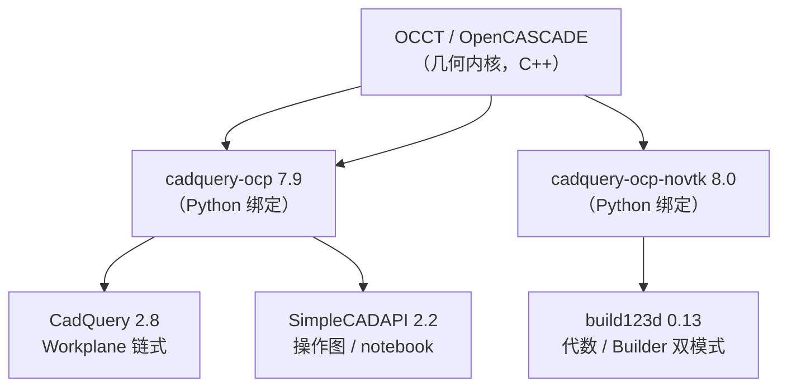

# 三个 Python CAD 库 · API 风格对比

> 同一句话、同一个模型，在六种 API 风格里分别怎么说。
> 所有代码均来自本工作区 `src/` 下的实际可运行文件，体积自检统一为 **41608.495**。

---

## 0. 先看血缘：它们为什么长得像，又为什么不像



三者的**几何内核是同一个** —— OCCT。这就是为什么：

- 三个库都能用同一套 `ocp_vscode` / OCP CAD Viewer 可视化
- 同一个模型在三个库里算出的体积能精确对上（`41608.495`）
- 依赖里反复出现 `cadquery-ocp` 和 `cadquery-ocp-novtk` 两兄弟

差异**全在 API 层**，即「你怎么描述一个形体」。这也是唯一值得对比的地方。

| | CadQuery | build123d | SimpleCADAPI |
|---|---|---|---|
| 绑定 | `cadquery-ocp 7.9` | `cadquery-ocp-novtk 8.0` | `cadquery-ocp 7.9` |
| 血缘 | OCCT 直系 | OCCT 直系（社区新一代） | 独立项目，OCCT 之上 |
| 设计目标 | 脚本化建模 | 更 Pythonic 的 CAD | **给 AI / agent 用的 CAD** |
| 官方风格数 | **1** | **2**（平级） | **3**（有主次） |
| 本工作区文件 | `cadquery/compare_model.py` | `compare_model.py` + `compare_model_builder.py` | `compare_model.py` + `_notebook` + `_decorator` |

一句话概括三者取向：

- **CadQuery** —— *"沿着一个工作平面走，像用游标卡尺量着做。"*
- **build123d** —— *"用算式的加减法拼形体，或者像用 CAD 软件画特征树。"*
- **SimpleCADAPI** —— *"每一步都记成操作图，可以导出、重放、被 AI 生成。"*

---

## 1. 六个文件，六种范式 · 总览

| # | 文件 | 范式 | 核心机制 | 状态模型 |
|---|---|---|---|---|
| ① | `cadquery/compare_model.py` | **链式 fluent** | 方法链 + Workplane 游标 | 有状态（游标栈） |
| ② | `build123d/compare_model.py` | **代数** | 运算符重载 `+ -` | **无状态**（纯函数） |
| ③ | `build123d/compare_model_builder.py` | **Builder** | `with` 上下文管理器 | 有状态（隐式栈） |
| ④ | `simplecad/compare_model.py` | **命令式脚本** | 显式函数 + `GraphSession` | 有状态（显式对象） |
| ⑤ | `simplecad/compare_model_notebook.py` | **响应式 notebook** | marimo cell 依赖图 | **无状态**（cell DAG） |
| ⑥ | `simplecad/compare_model_decorator.py` | **声明式** | `@scad.part` 装饰器 | 有状态（每次调用独立 session） |

六份文件共享**完全相同的参数块和自检块**，只有中间「建模段」不同 —— 可以直接并排 diff。

---

## 2. 四种「有状态 vs 无状态」的分水岭

这是最本质的分类维度：

### 2.1 无状态（纯函数式）

```python
# ② build123d 代数模式
part = Box(80, 50, 10, align=(...))
part += Pos(0, 0, 10) * Cylinder(12, 14, align=(...))
part -= Pos(0, 0, -1) * Cylinder(6, 26, align=(...))
```

每个表达式**自带完整的输入输出**，没有隐藏上下文。读一段代码不需要知道前面发生了什么。
好处：可测试、可并行、可随手重排、容易 diff。
代价：重复位移要重复写 `Pos(...)`。

### 2.2 有状态（隐式上下文）

```python
# ③ build123d Builder 模式
with BuildPart() as bp:
    Box(80, 50, 10, align=(...))
    with Locations((0, 0, 10)):
        Cylinder(12, 14, align=(...))
    with GridLocations(2*CX, 2*CY, 2, 2):
        Cylinder(4, 12, align=(...), mode=Mode.SUBTRACT)
```

`Box(...)` 一行里看不出它加到哪去了 —— 它加到「当前零件」。这叫**隐式接收者**。
好处：代码短，接近 CAD 软件特征树的思维。
代价：读代码必须**脑内维护栈**，缩进层级就是状态深度。

### 2.3 有状态（显式对象）

```python
# ④ SimpleCADAPI 命令式
with GraphSession(graph_id="compare_model") as session:
    plate = scad.make_box_rsolid(...)
    body = scad.union_rsolid(plate, boss)
    body = scad.cut_rsolid(body, bore, *corner_holes)
```

状态被**具名化**了：`session` 是个你能拿到手的对象，还能 `export_model_json()`。
这是介于二者之间的形态 —— 有状态，但状态可见、可导出、可重放。

### 2.4 有状态（链式游标）

```python
# ① CadQuery
part = (
    cq.Workplane("XY")
    .box(80, 50, 10, centered=(True, True, False))
    .faces(">Z").workplane().circle(12).extrude(14)
    .faces(">Z").workplane().hole(12)
)
```

`Workplane` 是一个**游标**：`.` 之后的每个操作都作用在「当前选中的东西」上。
`faces(">Z")` 把游标移到最高的面，`.workplane()` 铺一张新草图平面。
好处：极其紧凑，一行一特征，读起来像流水账。
代价：`.faces(">Z")` 依赖**字符串选择器**，是运行时才报错的字符串 DSL，IDE 帮不上忙。

---

## 3. 定位哲学：三种完全不同的「东西放哪」

同一个需求 —— *「在底板上表面中心放一个 ⌀24 高 14 的凸台」* —— 三种表达：

| | 表达方式 | 说的是什么 |
|---|---|---|
| **CadQuery** | `.faces(">Z").workplane().circle(12).extrude(14)` | 说的是**关系** ——「最高的那个面」 |
| **build123d** | `Pos(0, 0, 10) * Cylinder(12, 14, align=(..., Align.MIN))` | 说的是**变换** ——「先建，再平移」 |
| **SimpleCADAPI** | `make_cylinder_rsolid(radius=12, height=14, bottom_face_center=(0, 0, 10))` | 说的是**位置** ——「底面中心在 (0,0,10)」 |

三种哲学各有代价：

- **CadQuery 的选择器**最"聪明"但也最脆。改模型导致面序变化，`">Z"` 可能选中别的面；
  字符串写错了要到运行时才知道。但它让「在这个面上再来一个特征」变得极自然。
- **build123d 的 `Pos * Shape`** 最符合数学直觉，但 `align=` 是必须记住的隐式约定：
  `Align.MIN` 意味着「把局部坐标的底面贴到 Pos 指的位置」，不写就变成绕中心。
- **SimpleCADAPI 的 `bottom_face_center=`** 语义最直白（"底面中心"就是底面中心），
  代价是每个基本体都多一个长关键字参数，且**失去了「相对定位」能力** —— 你必须自己
  算 `PLATE_T` 才能知道凸台该放哪，没法说「放在底板上面」。

> 一个信号：CadQuery 和 build123d 都在用 `align` / `centered` 这类**居中开关**，
> 而 SimpleCADAPI 直接取消了这个自由度 —— 一律 "底面中心"。参数少一个，
> 表达力也少一截。这是面向 AI 生成时的一种取舍：**歧义越少越好**。

---

## 4. 布尔运算：藏起来、当运算符、还是当函数

```python
# ① CadQuery —— 布尔被藏进 Workplane，看不见
.faces(">Z").workplane().hole(12)        # 这是减！但代码里没有"减"字
.circle(12).extrude(14)                  # 这是加！但代码里没有"加"字

# ②/③ build123d 代数 —— 直接当运算符
part += Pos(0, 0, 10) * Cylinder(...)    # 加
part -= Pos(0, 0, -1) * Cylinder(...)    # 减

# ③ build123d Builder —— 声明式
Cylinder(..., mode=Mode.SUBTRACT)        # 用参数声明"这次是减"

# ④/⑤/⑥ SimpleCADAPI —— 独立函数
body = scad.union_rsolid(plate, boss)
body = scad.cut_rsolid(body, bore, *corner_holes)   # 注意：变参！
```

四个关键观察：

1. **CadQuery 的布尔是隐式的**。`hole()` 之所以是减，仅仅因为它叫 "hole"。
   这是便利，也是隐式约定 —— 你得知道有这么个函数才能读懂。

2. **`mode=Mode.SUBTRACT` 是 Builder 模式的精髓**：同一个 `Cylinder(...)`，
   加一个参数就从"长出材料"变成"挖掉材料"。几何代码完全不变。

3. **SimpleCADAPI 的 `cut_rsolid` 支持变参** —— `cut_rsolid(body, bore, *corner_holes)`
   一次减掉 5 个工具体。这是三个库里唯一直接支持「一次多个工具体」的布尔 API，
   另外两个都得循环或走阵列。

4. **build123d 的 `Cylinder` 参数是半径**，而 CadQuery 的 `hole()` 收的是**直径**，
   同一个库里的 `circle()` 又收半径。这是最容易踩的坑：

| 调用 | 收的是 |
|---|---|
| CadQuery `circle(r)` | 半径 |
| CadQuery `hole(d)` | **直径** |
| build123d `Cylinder(r, h)` | 半径 |
| SimpleCADAPI `make_cylinder_rsolid(radius=, height=)` | 半径（关键字明确） |

---

## 5. 阵列 / 重复：四种「打四个角孔」的写法

```python
# ① CadQuery —— pushPoints 一次下多个点
.pushPoints([(sx*CX, sy*CY) for sx in (-1,1) for sy in (-1,1)]).hole(8)

# ② build123d 代数 —— 老老实实循环
for sx in (-1, 1):
    for sy in (-1, 1):
        part -= Pos(sx*CX, sy*CY, -1) * Cylinder(...)

# ③ build123d Builder —— 位置上下文批量
with GridLocations(2*CX, 2*CY, 2, 2):
    Cylinder(..., mode=Mode.SUBTRACT)

# ④ SimpleCADAPI —— 列表推导 + 变参
corner_holes = [make_cylinder_rsolid(..., bottom_face_center=(sx*CX, sy*CY, -1))
                for sx in (-1,1) for sy in (-1,1)]
body = scad.cut_rsolid(body, bore, *corner_holes)
```

| 风格 | 阵列机制 | 备注 |
|---|---|---|
| CadQuery | `pushPoints` / `rarray` / `polarArray` | **内建最丰富**，含极坐标阵列 |
| build123d 代数 | 手写 for 循环 | 最朴素，但完全透明 |
| build123d Builder | `Locations` / `GridLocations` / `PolarLocations` | 与 CadQuery 的 `polarArray` 同级 |
| SimpleCADAPI | 列表推导（你自己拼） | 无内建阵列原语 |

**CadQuery 和 build123d 都有内建阵列原语，SimpleCADAPI 没有。**
后者的应对方式是"Python 本身就是阵列语言" —— 但这意味着你得自己算 `CX`、`CY`。

> `GridLocations` 的坑：它的跨度是 `spacing * (count - 1)`，
> 所以给 `2*CX` 配 `count=2` 才正好落在 `±CX`。给 `CX` 会得到间距减半的错误结果。

---

## 6. 状态检查：风格不一致的三种 API

同一个"这个模型体积多少"，三个库三种写法：

```python
actual = part.val().Volume()        # ① CadQuery —— 穿两层，方法，Volume 大写 V
actual = part.volume                # ② build123d —— 属性，最简洁
actual = body.get_volume()          # ④ SimpleCADAPI —— getter 方法，全小写
```

CadQuery 的 `part.val()` 暴露了一个事实：`Workplane` **不是**几何体，它只是游标的包装，
真正的 `Shape` 要 `.val()` 取出来。而 build123d 的 Builder 用 `bp.part` 取出成品后，
得到的就是货真价实的 `Part`，直接 `.volume`。

---

## 7. 可序列化 / 可重放：SimpleCADAPI 的独门绝技

另外两个库的模型对象**只活在内存里**。SimpleCADAPI 不同：

```python
# ④ 命令式脚本
model_json = export_model_json(session=session)
rebuilt = replay_model_json(json_str=model_json)     # 从 JSON 重建模型

# ⑥ @part 装饰器
result = compare_model()
rebuilt = result.replay()                            # 从特征图重建
```

它把每一步建模操作记成**有向图**（`GraphSession.graph.node_count` 能数结点数），
并支持：

| 能力 | API | 用途 |
|---|---|---|
| 记录操作图 | `GraphSession` | 自动捕获每次建模调用 |
| 导出 | `export_model_json(session=)` | 存成 JSON，可版本控制 |
| 重放 | `replay_model_json(json_str=)` / `result.replay()` | 从 JSON 重建几何 |
| 语义标记 | `apply_tag(shape=, tag=)` | 给几何体打业务标签（如 `"role.compare.plate_boss"`） |
| 几何查询 | `QL` | 按几何事实查询，而非按创建顺序 |
| 封装 | `@scad.part(id=...)` | 做成可复用的"零件函数" |

这是一套**为 AI agent 设计**的架构：LLM 生成 JSON 图 → 重放成几何 → 用 tag/QL 反查。
CadQuery 和 build123d 没有这个层次，它们的产物是"一个 Python 对象"，
序列化要你自己 diag。

> 但注意 `@part` 的**硬性约束**（读源码 `build/part_builder.py` 确认）：
> 函数必须返回**恰好一个** `Solid` 或 `Part`，否则抛
> `ArtifactValidationError: solid_cardinality_invalid`；
> 且函数体内**不能**再开 `GraphSession`（每次调用已有独立 session，会冲突）。

---

## 8. Notebook / 交互性对比

| | CadQuery | build123d | SimpleCADAPI |
|---|---|---|---|
| 主形态 | `.py` 脚本 | `.py` 脚本 | **marimo notebook** |
| 交互编辑器 | CQ-Editor（第三方，独立进程） | OCP CAD Viewer / build123d 的 `show()` | `sca edit` + `sca run` |
| 参数滑条 | 无内建 | 无内建 | **`scad.var("name", 80.0, unit="mm")` 自动生成滑块** |
| cell 级缓存 | — | — | ✅ 改一个参数只重跑受影响的 cell |
| 重跑方式 | 整脚本 | 整脚本 | `sca run file.py`（**不是** `python file.py`） |

`compare_model_notebook.py` 的每个特征是一个独立 cell，依赖靠**函数返回值**声明：

```python
@app.cell
def _(PLATE_L, PLATE_T, PLATE_W):          # ← 入参就是依赖声明
    plate = scad.make_box_rsolid(...)
    return (plate,)                         # ← 出参就是依赖导出
```

这带来一个 CadQuery/build123d 完全不具备的能力：**改 `PLATE_L` 只重跑下游 cell**。
但它也有代价 —— 代码被**物理打散**了，`.py` 文件里从头读到尾已经读不出建模流程，
必须靠 marimo 的 DAG 图来看。

> `scad.var()` 的坑：带单位的变量**不能**和裸数字在同一条加减表达式里混用。
> 例如 `PLATE_T + BOSS_H + 2.0`，如果 `PLATE_T` 是带单位变量，`+ 2.0` 会炸。

---

## 9. 可视化：同一套 viewer，两种传法

三个库都能用 OCP CAD Viewer（`ocp_vscode.show()`），但**传的东西不一样**：

```python
show(part)                  # CadQuery —— 传 Workplane 对象本身
show(part)                  # build123d —— 传 Part / Shape 对象本身
show(body.wrapped)          # SimpleCADAPI —— 必须取 .wrapped
```

**`.wrapped` 是关键**：`simplecadapi` 的实体类（`Solid` / `Face` / `Edge` /
`Wire` / `Shell` / `Compound`）都持有一个 `.wrapped` 属性，指向底层的 OCP 拓扑对象。
OCP CAD Viewer 只认 OCP 对象，所以桥接就是加一个 `.wrapped`。

```python
show(body.wrapped)                  # ④ 命令式：body 是 Solid
show(result.value.body.wrapped)     # ⑥ @part：要从 PartBuildResult 里挖两层
```

同时 SimpleCADAPI **有自己的可视化体系**（`sca edit` 网页编辑器、marimo 内嵌渲染、
GLB 导出），`ocp_vscode` 只是外来桥接，不是它的原生路径。

> 端口提醒：`ocp_vscode` 默认占 **3939** 端口，**一次只跑一个 `show()` 脚本**，
> 否则互相抢占。

---

## 10. 选择建议

| 你的场景 | 推荐 | 理由 |
|---|---|---|
| 只想快速出个零件、写脚本 | **CadQuery** | 最短的代码量，内建阵列最丰富，生态最成熟 |
| 想写"能读懂的几何代码"、要做参数化产品 | **build123d 代数模式** | 无状态，每个表达式自足，好测试好 diff |
| 从 SolidWorks / FreeCAD 转过来 | **build123d Builder 模式** | 特征树的思维模型直接迁移 |
| 要做 AI / LLM 生成 CAD | **SimpleCADAPI** | 唯一有操作图、JSON 序列化、语义 tag 的 |
| 要做参数探索 / 交互调参 | **SimpleCADAPI notebook** | 唯一有 cell 缓存和自动滑块 |
| 要封一个标准件库复用 | **SimpleCADAPI `@part`** | 唯一有"零件函数"概念的 |

**一句话总结三者气质：**

- **CadQuery** 是**管道**：数据从上游流到下游，你在 `.` 链上搭接。
- **build123d** 是**代数**：形体是值，`+ - *` 是运算，你写算式。
- **SimpleCADAPI** 是**图**：每一步是结点，整个模型是一张可导出的 DAG。

---

## 11. AI CAD 视角：让 LLM 写这些代码时的优缺点

前 10 节都是从**人的角度**评价 API。但只要代码是 AI 生成的，评价标准就要全部重来。

### 11.1 先立判据：AI 的失败模式和人不一样

人在 CAD 里犯错，是「想错了」。LLM 犯错，是**四种可预测的机械错误**：

| 失败模式 | 典型表现 |
|---|---|
| **API 幻觉** | 调用不存在的参数名、记错签名 |
| **量纲混淆** | 半径当直径（最常见）；角度当弧度 |
| **状态错位** | 隐式上下文里漏一个 `Mode.SUBTRACT`、缩进错一层 |
| **静默跑偏** | 代码能跑、不报错、几何是错的 |

关键点：**前三种都可能被工具链拦住，第四种不能** —— 它只能靠语义自检。
所以评价一个 API 的「AI 友好度」，核心只问一句：**它把错误暴露得多早、多响亮。**

### 11.2 实测：两个真实的静默失败

拿本工作区的模型跑了两个控制实验（脚本实际执行，数据如下）：

**实验一 · build123d Builder 模式忘了 `mode=Mode.SUBTRACT`**

```
正确（写了 Mode.SUBTRACT）    → 无异常, 体积=41608.495, 偏差=0.000
错误（忘了 Mode.SUBTRACT）    → 无异常, 体积=46961.769, 偏差=5353.274
```

**实验二 · CadQuery 把半径当直径传给 `hole()`**

```
正确（hole 传直径 2r）        → 无异常, 体积=41608.495, 偏差=0.000
错误（hole 传了半径 r）       → 无异常, 体积=45152.212, 偏差=3543.717
```

两个都是**零异常**。代码跑完了，图形出来了，东西是错的。
如果没有体积自检，人类审查者要盯着 3D 视图看出「孔小了三分之一」—— 基本不可能。

> **结论：无论用哪个库，AI CAD 流程都必须在生成代码里内建自检。**
> 好消息是体积自检是三库通用的（见 §11.6）。

### 11.3 硬数据：API 表面积与静态可检查性

探针脚本直接跑在各隔离环境里，实测结果：

| 指标 | CadQuery | build123d | SimpleCADAPI |
|---|---|---|---|
| 状态载体类 | `Workplane` | `BuildPart` | `GraphSession` |
| 该类的公开方法数 | **107** | 21 | 14 |
| 顶层公开名 | 44 | **494** | 385 |
| 其中枚举类 | 0 | 37 | 11 |
| 顶层函数 | 2 | 87 | **244** |
| 顶层函数签名全注解率 | （n=2，无统计意义） | 68% | **96%** |
| 附带 `py.typed` | ✅ | ✅ | ✅ |

三个数字最有信息量：

**① CadQuery 的表面积藏在 `Workplane` 里（107 个方法）**
顶层只有 44 个名字，看着很「小」，但真正的 API 是 `Workplane` 上的 107 个方法
—— 链式风格必然如此：能力堆在一个状态对象上。
对 LLM 的含义：上下文里「我有一个 Workplane」之后，模型要在 **107 个方法里选对那一个**。

**② build123d 是「宽而浅」**
494 个顶层名，但状态载体 `BuildPart` 只有 21 个方法。
能力主要靠**顶层构造类**（`Box` / `Cylinder` / `Pos` / `Locations`…）表达，
这是「代数」风格的结构特征。37 个枚举类（`Align` / `Mode` / `Axis` / `Plane`…）
是**有限命名空间** —— 对 LLM 反而是好事：枚举值可补全、可静态校验。

**③ SimpleCADAPI 的注解覆盖最完整（96%）**
244 个顶层函数里 235 个签名全注解 → **Pylance 能替 LLM 拦住大部分参数错误**。
配合它高度规则的双后缀命名（`make_*_rsolid` 造体 / `*_rsolid` 运算），
模型几乎能靠命名规律外推正确用法。

### 11.4 六个范式的逐项评估

#### ① CadQuery 链式 fluent —— ⚠️ 中风险

| | |
|---|---|
| ✅ | 训练语料**最丰富**，基础套路不用教；代码最短，token 效率最高 |
| ✅ | `pushPoints` / `polarArray` 内建阵列，减少模型手算坐标的机会 |
| ❌ | **字符串选择器 `faces(">Z")` 无法静态检查** —— 写错只在运行时炸，且报错通常不指向根因 |
| ❌ | 整段是**一个巨型表达式**：一处小改要重写整条链 → diff 噪声大，多轮迭代容易「越改越乱」 |
| ❌ | `circle(r)` 收半径、`hole(d)` 收直径 —— **同库内不一致**，是量纲幻觉的头号温床 |
| ❌ | 体积要 `part.val().Volume()`，两个非常规点（`.val()` 穿透 + 大写 `Volume`） |

实测它的静默失败偏差 3543.717，**全部来自半径/直径混淆**。

#### ② build123d 代数模式 —— ✅ 低风险，推荐给 AI

| | |
|---|---|
| ✅ | **无状态**，每个表达式自足 → LLM 每轮重写整段代码时不会「丢上下文」 |
| ✅ | `+` / `-` 是 Python 原生运算，不是字符串 DSL → **改错会报错** |
| ✅ | `align=(Align.CENTER, Align.CENTER, Align.MIN)` 枚举参数可补全、可校验 |
| ✅ | 局部修改 = 改一行 `part += ...`，diff 干净 |
| ❌ | `Pos(x,y,z) * Shape` 的**乘法语义**要专门教（乘法即变换，不是常见直觉） |
| ❌ | 忘写 `align=` 会静默变成绕中心对齐 → 几何错但不报错 |
| ❌ | 语料比 CadQuery 少，较新的 API 可能超出模型知识截止 |

#### ③ build123d Builder 模式 —— ⚠️ 中高风险

| | |
|---|---|
| ✅ | 结构最接近人类 CAD 心智模型，**生成的代码「看起来对」的程度最高** |
| ✅ | `GridLocations` / `Locations` 上下文，阵列不必手算坐标 |
| ❌ | **隐式状态 + 缩进敏感**：LLM 生成多级 `with` 嵌套时极易错位，而 Python 缩进错通常**不报错**（只是作用域变了） |
| ❌ | 忘写 `mode=Mode.SUBTRACT` → **静默变成加材料**（实测偏差 5353.274，零异常）。三个库里最危险的单一陷阱 |
| ❌ | 一行 `Cylinder(...)` 读不出它加到哪，需要脑内维护栈 —— **对人和对 LLM 都是** |

> **反直觉**：Builder 模式对人「更自然」，对 LLM 反而**更危险** ——
> 它的错误模式（漏参数、缩进错）恰好全是静默的。

#### ④ SimpleCADAPI 命令式脚本 —— ✅ 低风险

| | |
|---|---|
| ✅ | **关键字参数全名化**（`radius=` / `height=` / `bottom_face_center=`）→ 量纲幻觉几乎不可能 |
| ✅ | `cut_rsolid(body, bore, *holes)` 变参一次减多个 → 少写循环，少一处出错机会 |
| ✅ | 状态显式具名（`session`），每步是**独立语句**，局部修补粒度最细 |
| ✅ | 96% 签名注解 → 静态检查能拦住参数错误 |
| ❌ | **训练语料近乎为零** —— 模型不可能「知道」这个库，必须把 API 文档/示例喂进上下文（固定成本） |
| ❌ | 无内建阵列原语，坐标要手算（`CX = PLATE_L/2 - CORNER_INSET`）—— 手算就有算错空间 |
| ❌ | 失去了「相对定位」能力：没法说「放在底板上面」，必须显式算出 `PLATE_T` |

> **语料为零不一定是坏事**：它同时意味着模型**没有错误的先验**，
> 会老老实实照着你给的示例写，而不是自信地幻觉出一个 CadQuery 风格的调用。

#### ⑤ SimpleCADAPI notebook —— ✅ 中风险，潜力最大

| | |
|---|---|
| ✅ | **cell 即特征** —— 天然对应「一次改一个特征」的 agent 循环 |
| ✅ | 每个特征是一个独立 `def`，**diff 粒度最细**，改一个特征不牵动其它 cell |
| ✅ | 依赖靠**返回值显式声明**，LLM 加一个 feature cell 时有明确模板可循 |
| ✅ | `scad.var()` 自动生成参数滑块 → 人和 AI 共享同一个「可调参数」抽象 |
| ❌ | 代码被**物理打散**，从 `.py` 里读不出建模流程，必须理解 DAG |
| ❌ | 必须用 `sca run` 而非 `python` —— agent 的执行环境配置多一层出错点 |
| ❌ | 带单位变量不能与裸数字混算（`PLATE_T + BOSS_H + 2.0` 若 `PLATE_T` 带单位就炸） |

#### ⑥ SimpleCADAPI `@part` 装饰器 —— ✅✅ 最适合 agent 的接口

| | |
|---|---|
| ✅ | **签名即工具描述** —— `@scad.part(id=...)` 封装的函数，天然就是 LLM 的 tool 定义 |
| ✅ | **失败得响亮**：返回值不是恰好 1 个 Solid 就抛 `ArtifactValidationError: solid_cardinality_invalid`。宁可报错，绝不静默产出错误几何 —— 这正是 agent 需要的契约 |
| ✅ | 每次调用跑在独立 session，函数是**纯的**（无外部状态）→ 可重复、可测试 |
| ✅ | 产物可 `result.replay()` 重建，`definition` / `feature_graph` 可持久化 |
| ❌ | 必须返回**恰好一个** Solid —— LLM 若顺手返回 list 或 tuple 会失败（好在是响亮的失败） |
| ❌ | 函数体内不能再开 `GraphSession`（与外层冲突）—— 一条必须写进提示词的反直觉约束 |
| ❌ | 同样受「语料为零」制约 |

### 11.5 一张总表

| 范式 | 语料密度 | 静默失败风险 | 静态可检 | diff 友好 | 局部修补 | 自校验 | **AI 总分** |
|---|---|---|---|---|---|---|---|
| ① CadQuery 链式 | ★★★ | 中 | ❌ 字符串选择器 | ❌ 长链 | ❌ | 中 | ⚠️ 中 |
| ② build123d 代数 | ★★ | 中 | ✅ | ✅ | ✅ | ✅ | ✅ 高 |
| ③ build123d Builder | ★★ | **高** | ✅ | ✅ | 中 | ✅ | ⚠️ 中低 |
| ④ SCAD 命令式 | ☆ | **低** | ✅ 96% | ✅ | ✅ | ✅ | ✅ 高（需喂文档） |
| ⑤ SCAD notebook | ☆ | 低 | ✅ | ✅✅ | ✅ | ✅ | ✅ 高（需懂 DAG） |
| ⑥ SCAD `@part` | ☆ | **最低** | ✅ | ✅ | ✅ | ✅ | ✅✅ 最高（需喂文档） |

### 11.6 三个库通用的 AI CAD 铁律

这五条与选哪个库无关，属于流程层面。

**铁律 1 · 永远内建解析式自检。**

```python
expected = (80 * 50 * 10 + math.pi * 12**2 * 14
            - math.pi * 6**2 * (10 + 14) - 4 * math.pi * 4**2 * 10)
assert abs(part.volume - expected) < 1e-6, f"体积对不上: {part.volume} vs {expected}"
```

§11.2 那两个实验里的偏差（5353.274 和 3543.717）都会被这一行抓住。
**体积是 AI CAD 里最廉价、最可靠的真值来源** —— 不需要看图，不需要人审。

**铁律 2 · 优先用「会报错」的写法，避开「能跑但错」的写法。**
用 `mode=Mode.SUBTRACT` 而不是忘写；用关键字参数而不是位置参数；用枚举而不是字符串。

**铁律 3 · 一个特征一条语句。**
长链（CadQuery）和多级 `with` 嵌套（Builder）都会让 LLM 的局部修补退化成全局重写。
命令式和 notebook 形态天然满足这条。

**铁律 4 · 别指望模型「会」这个库。**
CadQuery 语料充足，可以直接问；SimpleCADAPI 语料近零，**必须把示例代码放进上下文**（few-shot）。
本工作区的六份 `compare_model*.py` 就是现成的 few-shot 材料 ——
参数块完全相同，只有建模段不同，正好演示「同一件事在这个库里怎么说」。

**铁律 5 · 让模型自证。**
提示词里要求「生成后报告实测体积与理论体积的偏差」，
模型就会主动做几何校验，而不是把「代码跑通了」当成「模型对了」。

### 11.7 本工作区的独门武器：三库交叉验证

这是这套隔离环境在 AI CAD 上的**真正价值** —— 不只是「能分别跑」。

同一个几何规格、**三个独立实现**、跑出同一个体积 → 这就是软件工程里的
**N 版本编程 / 差分测试（differential testing）**，可信度远高于单一实现跑通。

| 做法 | 可信度 |
|---|---|
| 一个库跑通、自检体积对 | 中 —— 可能自检公式本身也错 |
| **三个独立库 + 同一套自检公式都对** | **高** —— 三个独立 API 实现同时犯同一个错的概率极低 |

具体用法：

1. 让同一个 LLM 用三种 API 分别实现同一规格（正好是本工作区 6 份文件的由来）
2. 三个环境各自跑，比对体积
3. 三者一致 → 几何描述可信；某个不一致 → **那个库的代码有 bug**，且立刻知道是哪一个

> 尤其在**自检公式可能有误**时，交叉验证是唯一兜底：
> 三个库若都算出同一个值、而公式给出另一个值 —— 说明**公式错了**，不是三个库都错。

代价是三份代码要维护。但本工作区的六份文件**参数块与自检块逐字相同**，
这让「维护三份」退化成「维护一份参数 + 三段建模逻辑 + 一份公式」。

### 11.8 结论：给 AI CAD 的选型

| 场景 | 选择 |
|---|---|
| 让 LLM 直接写代码，不打算喂 API 文档 | **build123d 代数模式** —— 语料够用、无状态、会报错 |
| 让 LLM 写代码，愿意喂文档、要最高可靠性 | **SimpleCADAPI `@part`** —— 契约最严、失败最响 |
| 要 agent 反复迭代调参 | **SimpleCADAPI notebook** —— cell 级 diff 与缓存 |
| 要 agent 存/取模型状态 | **SimpleCADAPI** —— 唯一能把模型导出成 JSON 图 |
| 要人机混编、成果给人看 | **CadQuery** —— 可读性最好、社区最大 |
| 要**验证**另一个库的输出对不对 | **三个库一起上** —— 差分测试 |

一句话收束：

> 对人友好的 API 特性（隐式上下文、字符串选择器、简洁链式）**往往正是对 AI 危险的特性**；
> 而显得啰嗦的 API（全名关键字参数、严格契约、显式变量）**恰恰是 AI 需要的护栏**。
> **AI CAD 选型的核心不是「哪个写起来爽」，而是「哪个错了会喊」。**

---

## 12. 本工作区的运行方式

```powershell
cd "F:\AI_CAD"

# ① CadQuery 链式
& ".\envs\cadquery\Scripts\python.exe"   ".\src\cadquery\compare_model.py"

# ② build123d 代数
& ".\envs\build123d\Scripts\python.exe"  ".\src\build123d\compare_model.py"

# ③ build123d Builder
& ".\envs\build123d\Scripts\python.exe"  ".\src\build123d\compare_model_builder.py"

# ④ SimpleCADAPI 命令式
& ".\envs\simplecad\Scripts\python.exe"  ".\src\simplecad\compare_model.py"

# ⑤ SimpleCADAPI notebook —— 必须用 sca，不能用 python
& ".\envs\simplecad\Scripts\sca.exe" run ".\src\simplecad\compare_model_notebook.py"

# ⑥ SimpleCADAPI @part
& ".\envs\simplecad\Scripts\python.exe"  ".\src\simplecad\compare_model_decorator.py"
```

六行输出应全部为 `实测 41608.495` —— 这是三库一体同源的最终证明。

---

## 附：统一对比的模型定义

```
底板      80 × 50 × 10，底面在 z = 0
凸台      ⌀24（半径 12）、高 14，坐在底板上表面中心
中心通孔  ⌀12（半径 6），贯穿底板 + 凸台
四个角孔  ⌀8（半径 4），距边 8mm，贯穿底板

理论体积 = 80×50×10 + π×12²×14 − π×6²×(10+14) − 4×π×4²×10
         = 40000 + 6333.4508 − 2714.3361 − 2010.6193
         = 41608.4954  →  41608.495
```

六份代码的**参数块**与**自检块**逐字相同，只有「建模段」不同 —— 这是刻意的设计，
为的是让 diff 出来的每一行差异都纯粹来自 API 风格本身。
